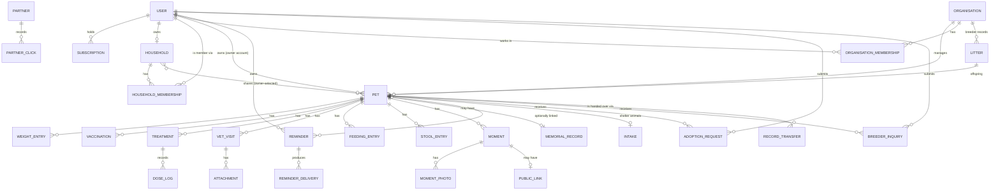

# PRD — Moj Ljubimac (Web)

## Document Control

| Field | Value |
|---|---|
| Product | Moj Ljubimac ("My Pet") — web application |
| Document | 02 — Product Requirements Document |
| Version | 1.6 |
| Date | 2026-10-19 |
| Author | Keti Vrtunić (interview facilitated by "Đura", Senior PM persona) |
| Traces to | `01-product-brief.md` v1.6 (2026-10-19); downstream: Technical Constraints v1.6 · Design System v1.5 · API Contract v1.2 |
| Status | Draft — awaiting owner review |

**Change log**

| Version | Date | Change |
|---|---|---|
| 1.0 | 2026-10-19 | Initial PRD covering CAP-01 … CAP-07. |
| 1.1 | 2026-10-19 | OQ-06, OQ-07, OQ-08 resolved: multiple channels per reminder type; household becomes read-only under an owner without Premium; breeder offspring statuses defined. |
| 1.2 | 2026-10-19 | Change requests from Technical Constraints interview: Apple sign-in deferred from v1 (requires a paid Apple Developer account); WhatsApp/Viber delivery capped per Premium user per month. |
| 1.3 | 2026-10-19 | Cap set to 30 messages per Premium user per month; Viber channel is built but stays switched off until the Operator enables it (Brief v1.5). |
| 1.4 | 2026-10-19 | Pet hotels (boarding) added as a partner type (Brief v1.6): FR-52, FR-54, FR-56, BR-43. |
| 1.5 | 2026-10-19 | FR-59 pet search; FR-21 covers editing and deleting manual reminders; FR-34 covers password reset; BR-46 organisation ownership when the last admin leaves; FR-60 organisation public profile editing; defaults confirmed in API Contract OQ-12 recorded as BR-47 … BR-52. |
| 1.6 | 2026-10-19 | Owner-approved change requests from the Build Plan review: CR-23 requirement count corrected to 60 (FR-01 … FR-60) in §1, §11 and Release Criterion 1; CR-18 BR-53 — a person invited to an organisation team keeps their own account type. |

---

## 1. Executive Summary

This PRD turns the seven v1 capabilities of the Moj Ljubimac Product Brief (v1.4) into 60 testable functional requirements (FR-01 … FR-60), grouped into seven epics: the pet health record, care log and moments, multi-channel reminders, household sharing, accounts and subscriptions, shelter and breeder organisation accounts, and local partners with an operator admin area. Each requirement carries a user story, Given/When/Then acceptance criteria, and a priority. The owner chose a single public launch with all seven capabilities complete, so every requirement is P0. During the interview, four Brief change requests were raised and applied to the Brief (v1.2 to v1.4).

---

## 2. Inherited Context (from Brief v1.4, 2026-10-19)

- **Problem:** pet owners in Serbia have no single, reliable place for their pet's health history and routinely miss time-sensitive care (Brief §2, founder assumptions).
- **Personas:** P1 Pet Owner (primary), P2 Household Member, P3 Animal Shelter (free), P4 Breeder (paid), P5 Partner (vet clinic, pet shop, grooming salon). Anti-personas: practice-management seekers, medical-advice seekers, retail-tooling seekers.
- **North-star metric:** active reminded pets, meaning pets with ≥ 1 delivered reminder in the trailing 30 days.
- **Constraints shaping priority:** web only; built and operated by one person; no deadline; running costs ≤ €20/month; Serbian (Latin) and English interface.

**Carried-forward open questions from Brief §16**

| Brief ID | Topic | Status in this PRD |
|---|---|---|
| OQ-01 | Proposed metric targets | Still open (see §15) |
| OQ-02 | Free vs Premium channels | Resolved in Brief v1.1 (email and push free, WhatsApp and Viber Premium) |
| OQ-03 | Premium and Breeder pricing | Still open (see §15) |
| OQ-04 | Partner pricing and placement | Placement resolved here (BR-40 … BR-42); pricing still open (see §15) |
| OQ-05 | Interface language | Resolved in Brief v1.4 (Serbian Latin + English) |

---

## 3. Epics

| Epic | Capability | Goal | Personas |
|---|---|---|---|
| EPIC-01 | CAP-01 Pet Health Record | Keep a pet's complete health history in one place, exportable for the vet. | P1, P2, P3, P4 |
| EPIC-02 | CAP-02 Care Log & Moments | Log daily nutrition and stool and capture shareable moments. | P1, P2 |
| EPIC-03 | CAP-03 Reminders & Multi-Channel Delivery | Deliver every care reminder on time through the user's chosen channels. | P1, P2 |
| EPIC-04 | CAP-04 Household Sharing | Let a household care for shared pets from the same record. | P1, P2 |
| EPIC-05 | CAP-05 Accounts, Subscriptions & Data Control | Let users join, pay for Premium, and control their data. | P1, P2, P3, P4 |
| EPIC-06 | CAP-06 Multi-Animal Organisation Accounts | Give shelters and breeders multi-animal management, adoption, litters, and record hand-over. | P3, P4 |
| EPIC-07 | CAP-07 Local Partners | Connect owners with nearby paying partners and let the operator run the programme. | P1, P5, Operator |

---

## 4. Domain & Relationship Overview

Conceptual entities and cardinality only, as confirmed by the owner.

**Notes**
- A user has exactly one account type: Owner, Shelter, or Breeder. Team membership in an organisation is separate from account type (BR-53).
- An owner owns at most one household. A user may be a member of several households.
- A pet belongs to exactly one owner account or one organisation. An organisation account has no personal pets.
- A litter references a mother (required) and a father (optional), both pets of the same breeder.

---

## 5. Traceability Matrix (CAP → Epic → FR)

| CAP | Capability | Epic | FRs | Status |
|---|---|---|---|---|
| CAP-01 | Pet Health Record | EPIC-01 | FR-01 … FR-13, FR-59 | ✅ Covered |
| CAP-02 | Care Log & Moments | EPIC-02 | FR-14 … FR-19 | ✅ Covered |
| CAP-03 | Reminders & Multi-Channel Delivery | EPIC-03 | FR-20 … FR-25 | ✅ Covered |
| CAP-04 | Household Sharing | EPIC-04 | FR-26 … FR-32 | ✅ Covered |
| CAP-05 | Accounts, Subscriptions & Data Control | EPIC-05 | FR-33 … FR-41 | ✅ Covered |
| CAP-06 | Multi-Animal Organisation Accounts | EPIC-06 | FR-42 … FR-51, FR-60 | ✅ Covered |
| CAP-07 | Local Partners | EPIC-07 | FR-52 … FR-58 | ✅ Covered |

---

## 6. User Stories & Functional Requirements

All requirements are **P0** (see §11).

### EPIC-01 / CAP-01 — Pet Health Record

**FR-01 — Create a pet profile**
*As a Pet Owner, I want to create a profile for my pet, so that its health history has a home.*
Fields: name\*, species\* (dog, cat, rabbit, hamster, guinea pig, chinchilla, ferret, bird, fish, turtle, lizard, snake, or "other" with free text), breed, sex\*, date of birth or approximate year, colour/markings, microchip number, passport number, spayed/neutered (yes / no / unknown), photo, "my vet" (name and phone), note.
- Given a Free user with no active pet, When they save a profile with all required fields, Then the pet appears as active.
- Given a Free user who already has one active pet, When they try to create another, Then creation is blocked and a Premium offer is shown.
- Given the species "other", When saving without the free-text species, Then saving is blocked with a message.

**FR-02 — Edit a pet profile**
*As a Pet Owner, I want to edit my pet's profile, so that it stays accurate.*
- Given an existing pet, When the owner changes any field and saves, Then the new values are shown everywhere the pet appears.

**FR-03 — Choose weight unit per pet**
*As a Pet Owner, I want to record weight in kilograms or grams per pet, so that small animals are measured sensibly.*
- Given a pet, When the owner sets the unit to grams, Then weight entries for that pet are entered and shown in grams.

**FR-04 — Log weight and see its history**
*As a Pet Owner, I want to log my pet's weight over time, so that I can follow changes.*
Fields: date\*, value\*, note.
- Given two or more weight entries, When the owner opens weight history, Then all entries are shown in date order as a trend over time.

**FR-05 — Record a vaccination**
*As a Pet Owner, I want to record each vaccination, so that I have proof and know when the next dose is due.*
Fields: vaccine name/type\*, date given\*, next dose date, vet/clinic, batch number, note.
- Given a vaccination with a next dose date, When it is saved, Then a vaccination reminder is created automatically (FR-20).
- Given a saved vaccination, When the owner edits or deletes it, Then the linked reminder is updated or removed accordingly.

**FR-06 — Record a treatment and log doses**
*As a Pet Owner, I want to record treatments and log each dose given, so that no dose is missed or doubled.*
Fields: type\* (medication / deworming / flea & tick protection / other), name\*, dose, frequency (every X hours or days), start date\*, end date or duration, note.
- Given a treatment with a frequency, When it is saved, Then dose reminders are created at that frequency until the end date (FR-20).
- Given a dose reminder, When a user marks the dose as given, Then a dose log entry is recorded with time and user.

**FR-07 — Record a vet visit**
*As a Pet Owner, I want to record vet visits, so that findings and follow-ups are kept.*
Fields: date\*, clinic/vet, reason\*, findings/diagnosis, recommendations, cost, check-up date, attachments.
- Given a visit with a check-up date, When it is saved, Then a check-up reminder is created automatically (FR-20).

**FR-08 — Attach files to a vet visit**
*As a Pet Owner, I want to attach images and PDFs to a visit, so that lab results and reports are kept with it.*
- Given a file that is an image or PDF of ≤ 10 MB, When attached, Then it is stored with the visit and can be opened.
- Given a file over 10 MB or of another type, When attached, Then it is rejected with a message.
- Given a Free user with 10 attachments on a pet, When they add an 11th, Then it is blocked and a Premium offer is shown.
- Given a Premium user, When adding attachments, Then there is no per-pet limit.

**FR-09 — Birthday from date of birth**
*As a Pet Owner, I want my pet's birthday known to the product, so that I get a birthday reminder.*
- Given a pet with a date of birth, When the profile is saved, Then a yearly birthday reminder is created (FR-20).

**FR-10 — Export the full record as PDF (Premium)**
*As a Pet Owner, I want to export my pet's full record as a PDF, so that I can give it to a vet, groomer, or border control.*
- Given a Premium user, When they export, Then a PDF containing the entire record is produced.
- Given a Free user, When they try to export, Then export is blocked and a Premium offer is shown.

**FR-11 — Move a pet to Memorial**
*As a Pet Owner, I want to move a pet that passed away or left to a memorial, so that its record is kept without active care.*
Fields: date\*, reason (passed away / rehomed / lost), note.
- Given an active pet, When moved to Memorial, Then all its reminders stop and it no longer counts toward the Free active-pet limit.
- Given a Free user with 2 memorials, When they try to add a third, Then it is blocked and a Premium offer is shown.
- Given a Premium user, When adding memorials, Then there is no limit.

**FR-12 — Restore a pet from Memorial**
*As a Pet Owner, I want to restore a pet from memorial (e.g., a lost pet is found), so that its care resumes.*
- Given a memorial pet and a free active slot, When restored, Then it becomes active and its reminders can be re-enabled.
- Given a Free user whose active slot is taken, When they try to restore, Then it is blocked and a Premium offer is shown.

**FR-13 — Permanently delete a pet**
*As a Pet Owner, I want to permanently delete a pet I created by mistake, so that it disappears completely.*
- Given a pet, When the owner confirms a single "Yes, delete" prompt, Then the pet and all its entries, attachments, moments, and reminders are permanently removed.

**FR-59 — Search my pets**
*As a Pet Owner or Organisation user, I want to search my pets by name, so that I find one quickly.*
- Given a list of pets, When the user types part of a name, Then only pets whose name contains the text (case- and diacritic-insensitive) are shown.
- Given no match, Then an empty result with the search term is shown.

### EPIC-02 / CAP-02 — Care Log & Moments

**FR-14 — Log feeding**
*As a Pet Owner, I want to log what and how much my pet eats, so that I can track nutrition.*
Fields: date and time\*, type\* (dry / wet / treat / home-made / other), name or brand, amount in grams, note.
- Given any user, When adding feeding entries, Then there is no limit on Free or Premium.

**FR-15 — Meal reminders**
*As a Pet Owner, I want reminders for meal times, so that feeding stays on schedule.*
- Given meal times (e.g., 08:00 and 18:00) and selected days (every day or chosen weekdays), When saved, Then a reminder is sent at each time on each selected day.

**FR-16 — Log stool**
*As a Pet Owner, I want to log stool, so that I can spot digestive problems.*
Fields: date and time\*, consistency\* (normal / soft / diarrhoea / hard), blood or mucus seen (yes/no), note.
- Given any user, When adding stool entries, Then there is no limit on Free or Premium.

**FR-17 — Create a moment**
*As a Pet Owner, I want to capture moments with photos and text, so that I keep my pet's memories.*
Fields: date\*, up to 5 photos, short text.
- Given a moment with 6 photos, When saving, Then saving is blocked with a message.
- Given a Free user with 5 moments on a pet, When adding a 6th, Then it is blocked and a Premium offer is shown.
- Given a Premium user, When adding moments, Then there is no limit.

**FR-18 — Share a moment as an image**
*As a Pet Owner, I want to share a moment as an image, so that I can post it on WhatsApp, Viber, or Instagram.*
- Given a moment, When shared as an image, Then the image shows the pet's name, the date, and the "Moj Ljubimac" logo.
- Given a Premium user, When they turn the logo off, Then the shared image has no logo.
- Given a Free user, Then the logo cannot be turned off.

**FR-19 — Share a moment as a public link**
*As a Pet Owner, I want a public link to a moment, so that anyone can see it without signing up.*
- Given a public link, When a Visitor opens it without signing in, Then they see only the moment (photos, text, pet name) and never any health data.
- Given an active link, When the owner disables it, Then the link no longer shows the moment.
- Given a moment with a link, When the moment is deleted, Then the link is disabled automatically.

### EPIC-03 / CAP-03 — Reminders & Multi-Channel Delivery

**FR-20 — Automatic reminders**
*As a Pet Owner, I want reminders created automatically from my records, so that I don't have to set them up twice.*
- Given a vaccination next-dose date, treatment frequency, vet-visit check-up date, meal schedule, or date of birth, When saved, Then the corresponding reminder exists without further action.

**FR-21 — Manual reminders**
*As a Pet Owner, I want my own reminders (e.g., "book grooming", "buy kibble"), so that the product covers everything I need to remember.*
Fields: title\*, linked pet (optional — a reminder may be for a pet or just for the user), date and time\*, repeat (none / daily / weekly / monthly / yearly).
- Given a manual reminder with repeat "monthly", When its time passes, Then the next occurrence is scheduled one month later.
- Given an existing manual reminder, When its owner edits or deletes it, Then future occurrences change or disappear; past history is kept.

**FR-22 — Lead times and delivery time per reminder type**
*As a Pet Owner, I want to choose how far ahead and at what time I'm reminded per type, so that reminders fit my routine.*
- Given a reminder type (e.g., vaccinations), When the user sets several lead times (e.g., 7 days before and on the day) and a delivery time, Then a notice is sent at each lead time at that time of day.
- Given medication doses and meals, Then they are always delivered at the exact scheduled time with no lead time.

**FR-23 — Delivery channels per reminder type**
*As a Pet Owner, I want to choose the channel per reminder type, so that urgent things reach me where I look.*
- Given any user, When choosing channels, Then email and push are available.
- Given a Premium user, When choosing channels, Then WhatsApp is also available, and Viber is available once the Operator has switched the Viber channel on.
- Given a Free user, When opening the channel choice, Then WhatsApp and Viber are shown as Premium-only.
- Given a Premium user who reached the monthly WhatsApp/Viber cap, When a further reminder is due that month, Then it is delivered by email and push.
- Given any reminder type, When the user selects several available channels (e.g., email and Viber), Then the reminder is delivered on each selected channel.

**FR-24 — Mark a reminder as done; repeat when ignored**
*As a Pet Owner, I want to mark a reminder as done from the message or the product, so that everyone knows it was handled.*
- Given a delivered reminder, When the user marks it done (from the message or in the product), Then it is shown as done with time and user.
- Given a delivered reminder not marked done within 30 minutes, Then it is re-sent once; if still not marked done, it is shown as missed.

**FR-25 — Premium expiry notices and channel fallback**
*As a Premium user, I want to know when Premium ends and keep getting reminders after it does, so that care isn't interrupted.*
- Given an active Premium subscription, When 30, 7, and 1 day(s) remain, Then the user receives an expiry reminder each time.
- Given any Premium user, When they open profile settings, Then the number of Premium days remaining is shown.
- Given Premium has expired, When a reminder previously set to WhatsApp or Viber is due, Then it is delivered by email and push instead.

### EPIC-04 / CAP-04 — Household Sharing

**FR-26 — Invite a household member (Premium)**
*As a Pet Owner, I want to invite household members, so that we care for the pet together.*
- Given a Premium owner, When they invite by email or by a link they send themselves, Then the invitee can join after signing in to their own account.
- Given an invitee without an account, When they open the invitation, Then they must create an account before joining.
- Given a Free owner, When they try to invite, Then it is blocked and a Premium offer is shown.
- Given a household with 6 members, When the owner invites another, Then it is blocked with a message.

**FR-27 — Choose which pets are shared**
*As a Pet Owner, I want to choose which pets my household sees, so that I control what is shared.*
- Given a household, When the owner shares or un-shares a pet, Then members gain or lose access to that pet.

**FR-28 — Member permissions**
*As a Household Member, I want to handle daily care for shared pets, so that I can help without changing the medical record.*
- Given a member, Then they can add weight entries, mark doses given, add feeding and stool entries, add moments, and mark reminders done.
- Given a member, Then they can view but not add or change vaccinations, treatments (other than marking doses), vet visits, attachments, or reminders.
- Given an entry created by another person, When a member tries to edit or delete it, Then the action is not available.

**FR-29 — Member reminders opt-in**
*As a Household Member, I want to choose whether I get reminders for shared pets, so that I'm not spammed.*
- Given a new member, Then they receive no reminders for shared pets until they switch them on.
- Given a member who switched reminders on, Then they receive them only by email and push, regardless of the owner's Premium.

**FR-30 — Leave or remove a member**
*As a Pet Owner, I want to remove a member (and members to leave), so that access stays current.*
- Given a member who leaves or is removed, Then they lose access and all entries they made remain in the record.

**FR-31 — Owner account deletion keeps the household**
*As a Household Member, I want the shared record to survive if the owner deletes their account, so that our pet's history isn't lost.*
- Given an owner whose account is permanently deleted, Then ownership passes to the earliest-joined member and the shared pets and records remain.
- Given the new owner has no Premium, Then the household becomes read-only for all members until the new owner has Premium (same as FR-32).

**FR-32 — Owner's Premium expires**
*As a Household Member, I want to keep seeing the record if the owner's Premium lapses, so that I'm not cut off.*
- Given an owner whose Premium expired, Then members keep read-only access to shared pets until Premium is renewed.

### EPIC-05 / CAP-05 — Accounts, Subscriptions & Data Control

**FR-33 — Register and choose account type**
*As a new user, I want to register as an owner, shelter, or breeder, so that I get the right tools.*
- Given a new user, When registering with email and password or Google, Then they choose an account type (Owner / Shelter / Breeder).
- Given registration with email and password, When the email is not yet verified, Then the product cannot be used until it is.

**FR-34 — Sign in and sign out**
*As a user, I want to sign in and out with the method I registered with, so that my data is mine only.*
- Given a registered user, When they sign in with their method, Then they reach their own data; When they sign out, Then no data is visible.
- Given a user who forgot their password, When they request a reset, Then they receive an email link that lets them set a new password once.

**FR-35 — Interface language**
*As a user, I want to use the product in Serbian (Latin) or English, so that I understand it.*
- Given any user, When they switch language, Then all product text is shown in the chosen language.

**FR-36 — Free tier limits**
*As a Free user, I want to know what Free includes, so that I understand when Premium is needed.*
- Given a Free owner, Then limits are: 1 active pet, 2 memorials, 10 attachments per pet, 5 moments per pet, email and push channels only, no PDF export, no household sharing, logo always on shared images.

**FR-37 — Subscribe to Premium with a trial**
*As a Pet Owner, I want to try and then buy Premium monthly or yearly, so that I unlock all features.*
- Given a user who never had a trial, When they start Premium, Then they get 7 days free before the first charge.
- Given a paid subscription, When its period ends, Then it renews automatically.

**FR-38 — Cancel Premium**
*As a Premium user, I want to cancel, so that I'm not charged again.*
- Given an active subscription, When cancelled, Then auto-renewal stops and Premium remains until the end of the paid period.

**FR-39 — Downgrade behaviour**
*As a former Premium user, I want to keep seeing everything, so that I lose no data.*
- Given a user whose Premium ended with more than Free allows, Then all existing pets, attachments, and moments remain visible, and adding new items beyond Free limits is blocked with a Premium offer.

**FR-40 — Delete account with a 30-day grace period**
*As a user, I want to delete my account, so that my data is removed.*
- Given a deletion request, Then the account is deactivated and permanently deleted after 30 days.
- Given a user within the 30 days, When they sign in and cancel deletion, Then the account is restored unchanged.

**FR-41 — Download all my data**
*As a user, I want a copy of all my data, so that I can keep it outside the product.*
- Given any user, When they request their data, Then they receive an archive with all their personal data and records.

### EPIC-06 / CAP-06 — Multi-Animal Organisation Accounts

**FR-42 — Shelter approval and breeder plan**
*As the Operator, I want to approve shelter accounts, so that the free tier isn't abused; as a Breeder, I want a paid breeder plan, so that I get breeder tools.*
- Given a newly registered Shelter, Then it cannot use the product until the Operator approves it.
- Given a Breeder, Then breeder features require an active breeder plan (separate price).
- Given an organisation account, Then it cannot hold personal pets.

**FR-43 — Organisation team**
*As an Organisation Admin, I want to add volunteers or staff, so that the team shares the work.*
- Given an organisation, Then it can have up to 20 users with role Admin or Volunteer.
- Given a Volunteer, Then they can add and edit health and care entries, but cannot delete animals, decide adoption requests or inquiries, or manage the team.

**FR-44 — Unlimited animals with full records**
*As a Shelter or Breeder, I want to keep a full health record for every animal, so that each one is cared for.*
- Given an organisation, Then it can manage any number of animals, each with the full record from EPIC-01.

**FR-45 — Shelter intake and status**
*As a Shelter, I want to record intake and track each animal's status, so that I know where every animal is.*
Intake fields: date\*, arrival type\* (found / surrendered by owner / confiscated / other), place found, note.
Statuses: Intake → In care → Available for adoption → Reserved → Adopted; exits: Deceased, Returned to owner.
- Given an animal, When its status changes, Then the new status and date are recorded.

**FR-46 — Public adoption page (Shelter)**
*As a Shelter, I want a public page of animals available for adoption, so that people can find them.*
- Given an animal "Available for adoption", Then it appears on the shelter's public page with photo, name, species, sex, approximate age, description, spayed/neutered yes/no, and vaccinated yes/no — and no detailed health record.

**FR-47 — Adoption requests**
*As a prospective adopter, I want to request an adoption, so that the shelter can consider me.*
- Given a signed-in user, When they submit name\*, phone\*, email\*, and a message, Then the shelter receives the request.
- Given a visitor without an account, When they try to request, Then they must create an account first.
- Given a request, When the shelter accepts it, Then the animal becomes Reserved and the applicant is emailed; When rejected, Then the applicant is emailed.

**FR-48 — Litters (Breeder)**
*As a Breeder, I want to record litters, so that each offspring has its own record from birth.*
Fields: mother\*, father, birth date\*, number of offspring.
- Given a saved litter, Then each offspring has its own pet record linked to the litter.

**FR-49 — Public breeder page and inquiries**
*As a Breeder, I want a public page with available offspring and prices, so that buyers can contact me.*
Offspring statuses: Available → Reserved → Sold.
- Given an available offspring, Then it appears on the breeder's public page with the same public fields as FR-46 plus price.
- Given a signed-in user, When they send an inquiry (name\*, phone\*, email\*, message), Then the breeder can accept or reject it and the user is emailed either way.
- Given an inquiry, When the breeder accepts it, Then the offspring becomes Reserved; When the sale is completed, Then it becomes Sold.

**FR-50 — Record transfer to the new owner**
*As a Shelter or Breeder, I want to hand the full record to the new owner, so that the animal's history follows it.*
- Given an adopted or sold animal, When the organisation sends a transfer invitation by email, Then the new owner receives the full record including attachments, and the organisation keeps a read-only copy.
- Given an invitation, Then it is valid for 30 days and can be re-sent.

**FR-51 — Transfer and the Free limit**
*As a new owner on Free, I want to know why I can't accept a second pet, so that I can decide.*
- Given a Free recipient whose active slot is taken, When accepting a transfer, Then it is blocked and a Premium offer is shown.

**FR-60 — Edit the organisation's public profile**
*As an Organisation Admin, I want to edit our description, contacts, and logo, so that our public page is accurate.*
- Given an Admin, When they save description, phone, email, website, or logo, Then the public page shows the new values within 5 minutes.
- Given a Volunteer, Then these fields are view-only.

### EPIC-07 / CAP-07 — Local Partners

**FR-52 — Partner directory**
*As a Pet Owner, I want to see nearby vets, pet shops, grooming salons, and pet hotels, so that I can reach them quickly.*
- Given the "Partners" section, Then only partners whose paid-until date has not passed are shown.
- Then featured partners appear first (max 3 per partner type per city), followed by the others ordered by distance.

**FR-53 — Determining "nearby"**
*As a Pet Owner, I want partners near me, so that suggestions are useful.*
- Given the user allowed location, Then distance is measured from their current location; otherwise from the city in their profile.

**FR-54 — Partner profile**
*As a Pet Owner, I want to see partner details, so that I know who they are.*
Fields: name\*, type\* (vet / pet shop / grooming salon / pet hotel), address\*, city\*, phone\*, email, website, Instagram, working hours, logo or photo, short description, preferred messaging channel.

**FR-55 — Quick actions**
*As a Pet Owner, I want one-tap contact, so that I can reach a partner instantly.*
- Given a partner, Then "Call", "Send message" (via the partner's chosen channel), "Send email", and "Visit website" are available where the partner has the data.

**FR-56 — Vet suggestion when no own vet**
*As a Pet Owner without a recorded vet, I want vet suggestions, so that I can find one.*
- Given a pet whose "my vet" is empty, Then the product suggests nearby vet partners. Pet shops, grooming salons, and pet hotels are shown only in the "Partners" section.

**FR-57 — Operator admin area**
*As the Operator, I want an admin area, so that I can run shelters and partners by hand.*
- Given a pending shelter, When the Operator approves or rejects it, Then the shelter is activated or informed.
- Given a partner, When the Operator creates or edits it (all FR-54 fields, featured flag, paid-until date), Then changes appear in the directory; When the paid-until date passes, Then the partner is hidden automatically.

**FR-58 — Partner click statistics**
*As the Operator, I want click counts per partner and action, so that I can show partners their value.*
- Given partner quick actions, Then each use of Call, Send message, Send email, and Visit website is counted per partner and shown in the admin area.

---

## 7. Use Cases

**UC-01 — Record a vaccination and get reminded (CAP-01)**
- **Actor:** P1 Pet Owner
- **Preconditions:** signed in; pet exists and is active.
- **Main success scenario:** 1. Owner records a vaccination with a next-dose date (FR-05). 2. A reminder is created automatically (FR-20). 3. The reminder is delivered by the chosen channels at the configured lead times (FR-22, FR-23). 4. Owner marks it done (FR-24).
- **Alternate / exception flows:** E-01 (vaccination edited or deleted), E-05 (reminder ignored), E-06 (Premium expired, fallback channel).
- **Postconditions:** vaccination stored; reminder delivered and marked done.

**UC-02 — Move a pet to Memorial and restore it (CAP-01)**
- **Actor:** P1 Pet Owner
- **Preconditions:** active pet exists.
- **Main success scenario:** 1. Owner moves pet to Memorial with date and reason (FR-11). 2. Reminders stop; Free slot is freed. 3. Later, owner restores the pet (FR-12).
- **Alternate / exception flows:** E-02 (Free memorial limit reached), E-03 (restore blocked, slot taken).
- **Postconditions:** pet is active again with full history.

**UC-03 — Share a moment (CAP-02)**
- **Actor:** P1 Pet Owner; Visitor
- **Preconditions:** a moment exists.
- **Main success scenario:** 1. Owner shares the moment as an image or creates a public link (FR-18, FR-19). 2. Visitor opens the link without signing in and sees only the moment.
- **Alternate / exception flows:** E-07 (link disabled or moment deleted), E-08 (Free moment limit).
- **Postconditions:** moment visible to link holders until disabled.

**UC-04 — Configure reminder delivery (CAP-03)**
- **Actor:** P1 Pet Owner
- **Preconditions:** signed in.
- **Main success scenario:** 1. Owner sets lead times, delivery time, and channels per reminder type (FR-22, FR-23). 2. Owner creates a manual reminder (FR-21). 3. Reminders arrive accordingly.
- **Alternate / exception flows:** E-09 (Free user picks WhatsApp/Viber), E-05 (reminder ignored).
- **Postconditions:** reminder settings saved and applied.

**UC-05 — Invite a household member (CAP-04)**
- **Actor:** P1 Pet Owner (Premium); P2 Household Member
- **Preconditions:** owner has Premium.
- **Main success scenario:** 1. Owner invites by email or link (FR-26). 2. Invitee signs in or registers and joins. 3. Owner selects shared pets (FR-27). 4. Member switches on reminders (FR-29) and logs daily care (FR-28).
- **Alternate / exception flows:** E-10 (Free owner), E-11 (6 members reached), E-12 (member edits others' entry), E-13 (owner's Premium expires), E-14 (owner deletes account).
- **Postconditions:** member has access to selected pets with member permissions.

**UC-06 — Start, cancel, and lapse Premium (CAP-05)**
- **Actor:** P1 Pet Owner
- **Preconditions:** signed in, email verified.
- **Main success scenario:** 1. Owner starts Premium with a 7-day trial (FR-37). 2. Subscription renews. 3. Owner cancels; Premium runs to period end (FR-38). 4. Expiry notices arrive (FR-25). 5. On expiry, downgrade rules apply (FR-39).
- **Alternate / exception flows:** E-15 (trial already used), E-06 (channel fallback).
- **Postconditions:** user on Free with all data visible.

**UC-07 — Delete account (CAP-05)**
- **Actor:** any user
- **Preconditions:** signed in.
- **Main success scenario:** 1. User downloads their data (FR-41). 2. User requests deletion (FR-40). 3. After 30 days the account is permanently deleted.
- **Alternate / exception flows:** E-16 (user cancels within 30 days), E-14 (user is a household owner).
- **Postconditions:** account and personal data removed.

**UC-08 — Shelter adoption with record transfer (CAP-06)**
- **Actor:** P3 Shelter (Admin); prospective adopter
- **Preconditions:** shelter approved by Operator (FR-42).
- **Main success scenario:** 1. Shelter records intake (FR-45). 2. Animal set to Available and shown publicly (FR-46). 3. Adopter submits a request (FR-47). 4. Shelter accepts → Reserved. 5. Shelter marks Adopted and sends a transfer (FR-50). 6. Adopter accepts and receives the full record.
- **Alternate / exception flows:** E-17 (requester has no account), E-18 (request rejected), E-19 (transfer link expired), E-20 (recipient on Free with slot taken).
- **Postconditions:** adopter owns the record; shelter keeps a read-only copy.

**UC-09 — Breeder litter and sale (CAP-06)**
- **Actor:** P4 Breeder
- **Preconditions:** active breeder plan.
- **Main success scenario:** 1. Breeder records a litter (FR-48). 2. Offspring shown publicly with price (FR-49). 3. Buyer sends inquiry; breeder accepts. 4. Breeder sends record transfer (FR-50).
- **Alternate / exception flows:** E-18, E-19, E-20, E-21 (breeder plan inactive).
- **Postconditions:** buyer owns the offspring's record.

**UC-10 — Contact a partner (CAP-07)**
- **Actor:** P1 Pet Owner; Operator
- **Preconditions:** Operator has created an active partner (FR-57).
- **Main success scenario:** 1. Owner opens Partners or receives a vet suggestion (FR-52, FR-56). 2. Owner taps a quick action (FR-55). 3. The click is counted (FR-58).
- **Alternate / exception flows:** E-22 (no location permission), E-23 (partner's paid-until passed), E-24 (partner missing a contact field).
- **Postconditions:** owner contacted partner; operator sees the click.

---

## 8. Business Rules & Logic

**Limits and tiers**
- BR-01: Free owner: 1 active pet, 2 memorials, 10 attachments per pet, 5 moments per pet; no PDF export; no household sharing; email and push only; shared images always carry the logo.
- BR-02: Premium owner: no limits on active pets, memorials, attachments, or moments; PDF export; household sharing; WhatsApp and Viber channels; optional logo removal.
- BR-03: Memorial pets do not count toward the Free active-pet limit.
- BR-04: Feeding and stool logs are unlimited on every tier.
- BR-05: Attachments are images or PDFs, ≤ 10 MB each.
- BR-06: A moment holds at most 5 photos.

**Subscriptions**
- BR-07: Premium is monthly or yearly, auto-renewing, with one 7-day trial per user.
- BR-08: Cancelling stops renewal; Premium lasts to the end of the paid period.
- BR-09: Expiry notices at 30, 7, and 1 day(s) before the end; remaining days always visible in profile settings.
- BR-10: After expiry, existing data stays visible; new items beyond Free limits are blocked.
- BR-11: Breeder accounts require a separate paid breeder plan.

**Reminders**
- BR-12: Reminders are created automatically from vaccination next-dose dates, treatment frequencies, vet check-up dates, meal schedules, and dates of birth.
- BR-13: Lead times (one or more) and delivery time are set per reminder type; doses and meals are always sent at their exact time.
- BR-14: Channels are chosen per reminder type, and several channels may be selected at once; email and push for all; WhatsApp and Viber for Premium.
- BR-14a: WhatsApp and Viber deliveries are capped per Premium user per month; once the cap is reached, further reminders that month are delivered by email and push. The cap is 30 WhatsApp/Viber messages per Premium user per calendar month.
- BR-14b: The Viber channel is built but hidden until the Operator switches it on; while it is off, users cannot select Viber.
- BR-15: An unacknowledged reminder is re-sent once after 30 minutes, then marked missed.
- BR-16: After Premium expiry, WhatsApp/Viber reminders fall back to email and push.
- BR-17: Memorial pets have no active reminders.
- BR-18: Manual reminders may be linked to a pet or only to the user, with repeat none / daily / weekly / monthly / yearly.

**Household**
- BR-19: Household sharing requires the owner to have Premium.
- BR-20: An owner owns at most one household; a household has at most 6 members; a user may belong to several households.
- BR-21: The owner chooses which pets are shared.
- BR-22: Members may add weight, mark doses, add feeding/stool entries, add moments, and mark reminders done; everything else is view-only.
- BR-23: Members edit or delete only their own entries.
- BR-24: Members use Free rules (owner's Premium does not extend to them); reminders for shared pets are off until the member switches them on, and use email and push only.
- BR-25: Only the owner can delete pets, invite or remove members, and manage the subscription.
- BR-26: When a member leaves or is removed, their entries remain.
- BR-27: When the owner's account is deleted, ownership passes to the earliest-joined member; if that member has no Premium, the household becomes read-only until they do.
- BR-28: When the owner's Premium expires, members keep read-only access.

**Accounts and data**
- BR-29: Registration via email + password or Google; email verification is mandatory. Apple sign-in is deferred beyond v1.
- BR-30: Each user has one account type: Owner, Shelter, or Breeder (team membership does not change it, BR-53).
- BR-31: Account deletion takes effect after a 30-day grace period during which it can be cancelled.

**Organisations**
- BR-32: Shelter accounts are free and require Operator approval before use.
- BR-33: Organisation accounts hold no personal pets and have no animal limit.
- BR-34: Organisation teams have up to 20 users, role Admin or Volunteer; Volunteers cannot delete animals, decide requests/inquiries, or manage the team.
- BR-35: Shelter statuses: Intake → In care → Available for adoption → Reserved → Adopted; exits Deceased and Returned to owner.
- BR-36: Adoption requests and breeder inquiries require a signed-in user; accepting a shelter request sets the animal to Reserved; accepting a breeder inquiry sets the offspring to Reserved (offspring statuses: Available → Reserved → Sold); applicants are emailed on accept and reject.
- BR-37: Public shelter and breeder pages show only public fields (FR-46, plus price for breeders), never the detailed health record.
- BR-38: Record transfers include the full record and attachments; the organisation keeps a read-only copy; invitations are valid 30 days and can be re-sent.
- BR-39: A Free recipient whose active slot is taken needs Premium to accept a transfer.

**Partners**
- BR-40: Only partners with a paid-until date not yet passed are shown.
- BR-41: Featured partners first (max 3 per partner type per city), then others by distance.
- BR-42: Distance is from current location if permitted, otherwise from the profile city.
- BR-43: Vet suggestions appear only when a pet has no "my vet"; pet shops, grooming salons, and pet hotels appear only in the Partners section.
- BR-44: "Send message" uses the messaging channel chosen in the partner's profile.

**Organisations**
- BR-46: When an organisation's last Admin deletes their account, the earliest-joined remaining team member becomes Admin; if no member remains, the organisation and its animals are deleted after the same 30-day grace period.
- BR-53: A person invited to an organisation team keeps their own account type; team membership (Admin or Volunteer) is separate from account type, so the same person can own pets and volunteer for a shelter.

**Confirmed defaults**
- BR-47: Household and team invitations are valid for 7 days.
- BR-48: Default reminder preferences: vaccinations 7 days before and on the day at 09:00; vet follow-ups 1 day before and on the day at 09:00; birthdays and manual reminders on the day at 09:00; doses and meals at their exact time; channels email + push.
- BR-49: The first treatment dose is due on the start date at 08:00 (or the next full hour if that has passed).
- BR-50: Changing a pet's weight unit converts all its existing weight entries.
- BR-51: Organisation animals have no automatic reminders in v1. The household limit of 6 includes the owner. Breeder plans have no trial.
- BR-52: An invitation or transfer link may be accepted by whoever holds it; the email is where it is sent, not a lock. Moment text is at most 280 characters.

**Public moments**
- BR-45: A public moment link shows only photos, text, and pet name; it can be disabled by the owner and is disabled automatically when the moment is deleted.

---

## 9. Edge Cases & Error States

| ID | Situation | Expected behaviour | FR |
|---|---|---|---|
| E-01 | Vaccination with a reminder is edited or deleted | Linked reminder updated or removed | FR-05 |
| E-02 | Free user adds a 3rd memorial | Blocked, Premium offer | FR-11 |
| E-03 | Free user restores a pet while the active slot is taken | Blocked, Premium offer | FR-12 |
| E-04 | Free user adds an 11th attachment, or any file > 10 MB / wrong type | Blocked with message (Premium offer for the limit) | FR-08 |
| E-05 | Reminder not marked done | Re-sent once after 30 minutes, then shown as missed | FR-24 |
| E-06 | Premium expired with WhatsApp/Viber reminders | Delivered by email and push | FR-25 |
| E-07 | Public link opened after it was disabled or the moment deleted | Moment not shown | FR-19 |
| E-08 | Free user adds a 6th moment on a pet, or a moment with 6+ photos | Blocked with message (Premium offer for the moment limit) | FR-17 |
| E-09 | Free user tries to choose WhatsApp or Viber | Shown as Premium-only | FR-23 |
| E-10 | Free owner tries to invite a member | Blocked, Premium offer | FR-26 |
| E-11 | Owner invites a 7th member | Blocked with message | FR-26 |
| E-12 | Member tries to edit or delete someone else's entry | Action not available | FR-28 |
| E-13 | Owner's Premium expires | Members keep read-only access | FR-32 |
| E-14 | Household owner deletes their account | Ownership passes to earliest-joined member; read-only if they have no Premium | FR-31 |
| E-15 | User who already had a trial starts Premium | No trial; charged immediately | FR-37 |
| E-16 | User cancels deletion within 30 days | Account restored unchanged | FR-40 |
| E-17 | Visitor without account requests adoption or sends an inquiry | Must create an account first | FR-47, FR-49 |
| E-18 | Request or inquiry rejected | Applicant emailed | FR-47, FR-49 |
| E-19 | Transfer invitation not accepted in 30 days | Invitation expires; organisation can re-send | FR-50 |
| E-20 | Free recipient with active slot taken accepts a transfer | Blocked, Premium offer | FR-51 |
| E-21 | Breeder plan inactive | Breeder features unavailable | FR-42 |
| E-22 | User denies location | Partners ordered by distance from profile city | FR-53 |
| E-23 | Partner's paid-until date passes | Partner hidden automatically | FR-57 |
| E-24 | Partner lacks email, website, or messaging channel | That quick action is not shown | FR-55 |
| E-25 | Free user tries PDF export or logo removal | Blocked, Premium offer | FR-10, FR-18 |
| E-27 | Viber channel switched off by the Operator | Viber not offered as a channel | FR-23 |
| E-26 | Free user tries to create a 2nd active pet | Blocked, Premium offer | FR-01 |

---

## 10. Non-Functional Requirements (Product-Level)

| ID | Requirement |
|---|---|
| NFR-01 | Reminders are delivered no later than 5 minutes after their scheduled time for ≥ 95% of reminders each month. |
| NFR-02 | All dates and times are in Serbian time (Europe/Belgrade). |
| NFR-03 | The product is fully usable on phones and computers, on screens from 360 px wide. |
| NFR-04 | Core flows are usable with keyboard only and with a screen reader, to WCAG 2.1 AA. |
| NFR-05 | Interface available in Serbian (Latin script) and English. |
| NFR-06 | Deleted accounts' data is permanently removed after the 30-day grace period. |
| NFR-07 | Memorial records are kept indefinitely while the account exists. |
| NFR-08 | History of sent reminders is kept for 12 months. |
| NFR-09 | Attachment size limit: 10 MB per file. |
| NFR-10 | Running costs stay within €20/month (Brief §13). |

---

## 11. Prioritization

The owner chose a **single public launch with all seven capabilities complete** (not wave-based). Therefore every requirement is **P0 / Must** for v1.

| Priority | FRs | Count |
|---|---|---|
| P0 (Must) | FR-01 … FR-60 | 60 |
| P1 (Should) | — | 0 |
| P2 (Could) | — | 0 |

> ⚠️ **Mismatch with constraints:** 60 P0 requirements for a single builder with no deadline means launch only happens when everything is done (see RISK-08). Internal build order is decided in the Build Plan; it does not change the launch bar.

---

## 12. Release Criteria / Definition of Done

v1 is shippable when all of the following are true:

1. All 60 P0 requirements (FR-01 … FR-60) are implemented and every acceptance criterion in §6 is verified.
2. Payments are tested end to end: trial, renewal, cancellation, expiry, downgrade, and breeder plan.
3. Account deletion (with grace period) and full data download work.
4. Privacy policy and terms of use are published at public URLs, in Serbian and English.
5. Delivered reminders are counted, so the north-star metric can be measured from day one.
6. The operator admin area works: shelter approval, partner management, paid-until hiding, click statistics.

---

## 13. Assumptions

_No new assumptions were recorded during this interview. Brief assumptions ASM-01 … ASM-09 remain authoritative._

---

## 14. Risks

| ID | Risk | Severity | Mitigation idea |
|---|---|---|---|
| RISK-08 | Single big-bang launch with 60 P0 requirements delays any user feedback and any revenue until everything is built. | High | Build in internal waves (Build Plan) and run private testing with a small group before the public launch. |
| RISK-09 | Push notifications to a web product on iPhone work only after the user saves the site to the home screen, so iPhone users may expect push that never arrives. | Medium | Explain this to iPhone users when they choose push; email remains available to everyone. |
| RISK-10 | Organisation features (adoption, litters, transfers, public pages, approvals) roughly double the product surface for segments with unvalidated demand (ASM-05, ASM-06). | Medium | Pilot with one shelter and one breeder during private testing. |

---

## 15. Open Questions

| ID | Origin | Question | Blocking for Technical Constraints? |
|---|---|---|---|
| OQ-01 | Brief | `[NEEDS CLARIFICATION]` Confirm proposed metric targets (300 active reminded pets, 5 partners, 3 shelters, 60% with a vaccination entry, all at 6 months). | No |
| OQ-03 | Brief | `[NEEDS CLARIFICATION]` Premium monthly and yearly prices; breeder plan price. | No |
| OQ-04 | Brief | `[NEEDS CLARIFICATION]` Partner pricing (standard vs featured). Placement rules resolved in BR-40 … BR-42. | No |
| OQ-06 | PRD | ✅ Resolved (v1.1): several channels may be selected per reminder type. | — |
| OQ-07 | PRD | ✅ Resolved (v1.1): household becomes read-only until the new owner has Premium. | — |
| OQ-08 | PRD | ✅ Resolved (v1.1): Available → Reserved → Sold; accepting an inquiry sets Reserved. | — |

---

## 16. Glossary Additions

Terms already defined in Brief §15 remain authoritative.

| Term | Definition |
|---|---|
| Memorial | State of a pet that passed away, was rehomed, or was lost: record kept, reminders off, not counted toward the Free active-pet limit. |
| Active pet | A pet not in Memorial. |
| Dose log | Record that a specific treatment dose was given, with time and user. |
| Lead time | How long before an event a reminder notice is sent; several may be set per reminder type. |
| Missed reminder | A reminder not marked done after its single re-send. |
| Household owner | The user who created the household; holds full rights and the subscription. |
| Household member | A user invited into a household with daily-care rights only. |
| Organisation Admin / Volunteer | Roles within a shelter or breeder team. |
| Intake | Record of how and when an animal entered a shelter. |
| Adoption request | A signed-in user's application to adopt a shelter animal. |
| Breeder inquiry | A signed-in user's request to buy a breeder's offspring. |
| Record transfer | Hand-over of an animal's full record from an organisation to its new owner. |
| Public page | A shelter's or breeder's page of available animals, visible without signing in. |
| Public link | A link that shows a single moment to anyone without signing in. |
| Visitor | Anyone viewing a public page or link without signing in. |
| Pet hotel | A partner offering boarding (accommodation) for pets while owners are away. |
| Featured partner | A partner shown at the top of its type in its city (max 3). |
| Paid-until date | Date after which a partner is automatically hidden. |
| Operator admin area | The owner's internal area for approving shelters and managing partners. |

---

## 17. Appendix

_None for v1._
